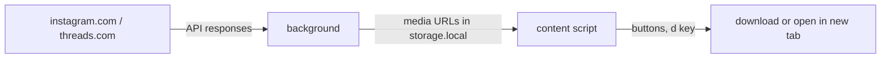

# Architecture

A Manifest V3 extension for Chrome and Firefox, written in TypeScript and bundled by esbuild. The popup and options pages use Preact.

## Build

`esbuild.config.mjs <chrome|firefox>` bundles the entry points into `dist/<platform>`, copies `public/` and writes `src/manifest.<platform>.json` as `manifest.json` with `__MSG_extVersion__` replaced by the `package.json` version. Add `--watch` to keep rebuilding.

## Pieces

| Path | Runs in | Role |
| --- | --- | --- |
| `src/background/firefox.ts` | Firefox background | Reads Instagram's GraphQL and REST responses with `webRequest.filterResponseData` and stores stories, reels, highlights and profile reels in `storage.local`. |
| `src/background/chrome.ts`, `src/inject.ts`, `src/xhr.ts` | Chrome background and page | Chrome can't read response bodies, so `inject.ts` loads `xhr.ts` into the page, which patches `XMLHttpRequest` and sends responses to the background. |
| `src/background/fn.ts` | both | Parses those responses into what the content script needs. |
| `src/content/loader.ts` | content script | Imports `content/index.js` as an ES module. |
| `src/content/index.ts` | content script | Picks the page handler for the current URL every 2 seconds, adds buttons and routes clicks. |
| `src/content/<page>.ts` | content script | One `PageHandler` per page type: post, home feed, stories, reels, profile reel, profile, Threads. |
| `src/content/shortcut.ts` | content script | Fork-only. The `d` key clicks the visible download button nearest the viewport center. |
| `src/content/utils/` | content script | Filenames, zip downloads, video helpers, settings cache. |
| `src/mute-lock.ts` | page | Keeps a reel's sound setting when Instagram's tap handler tries to toggle it. |
| `src/popup/`, `src/options/` | extension pages | Settings, stored in `storage.sync` under the keys in `src/constants.ts`. |

## Fragile parts

Instagram changes its markup and API often. When a button stops appearing or downloads the wrong file, the cause is almost always a selector in a page handler or a response shape in `src/background/fn.ts`. Check upstream's issues and recent commits first, since a fix often lands there.
